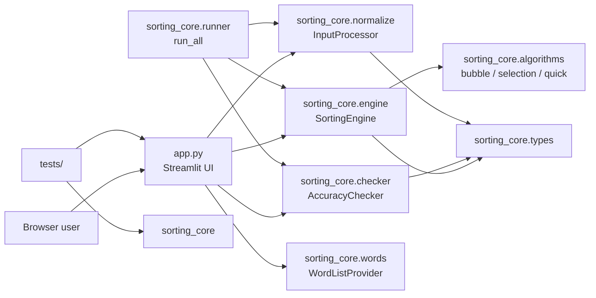
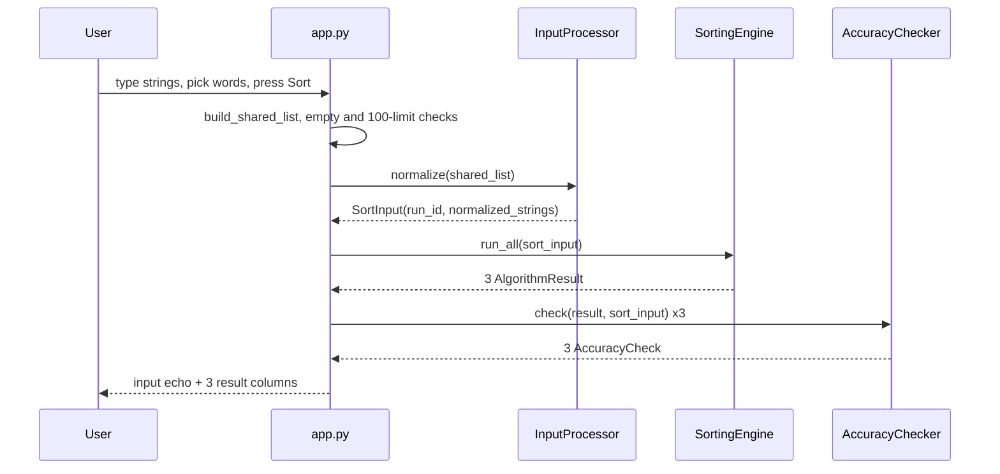

# Architecture — sort_diff

## System Overview
A single-process Python application: a Streamlit entry script (`app.py`) that renders the UI and delegates all sorting work to a pure-stdlib package (`sorting_core/`). There is no persistence, no network I/O, and no background worker.

## Architectural Style
Modular monolith with a strict presentation/domain split (evidence: `app.py` module docstring, ADR-004 reference; `sorting_core/__init__.py` "No I/O, no markup, no network"). `app.py` imports only from `sorting_core`; `sorting_core` imports nothing from `app.py` or Streamlit.

## Component Relationships

Text fallback: `app.py` depends on `normalize`, `engine`, `checker`, and `words`. `engine` depends on `algorithms` and `types`. `checker` and `normalize` depend on `types`. `runner` composes normalize, engine, and checker, but `app.py` does not call it. `tests` exercise both `app.py` (via AppTest) and `sorting_core`.

## Data Flow
1. Widgets return `typed_text` (str) and `picked_words` (list[str]).
2. `build_shared_list` splits and de-duplicates them, preserving first-seen order.
3. Limit and empty checks run in `app.py`.
4. `InputProcessor().normalize` returns a `SortInput` with a fresh UUID4 `run_id`.
5. `SortingEngine().run_all` runs the three algorithms on the same normalized list, each with a reset shared `Counter`, returning three `AlgorithmResult`.
6. `AccuracyChecker().check` compares each result to `sorted(normalized_strings)`.
7. `render_results` writes everything through plain `st.markdown` and `st.text`.

No result is cached or stored between reruns (`app.py` comments PD-1, PD-2).

## Interaction Diagram

Text fallback: the user submits input; the app builds the shared list, normalizes it, runs the three algorithms, checks each against `sorted()`, and renders three columns.

## Key Design Decisions
- Presentation-only UI; core is pure stdlib and testable without Streamlit (`sorting_core/__init__.py`).
- Exceptions from the core propagate to Streamlit by design; `app.py` has no try/except (`app.py` SD-6 comment).
- No `unsafe_allow_html`; user text rendered as plain strings (`app.py` SD-2 comment; enforced by `tests/ui/test_app.py::test_source_uses_no_unsafe_html_and_no_eval_or_exec`).
- The project is not installed as a package; tests reach `sorting_core` through `pytest` `pythonpath = ["."]` (`pyproject.toml`).

## Deployment Topology (as configured)
- Local: `streamlit run app.py` (`README.md`).
- Dev container: `postAttachCommand` runs Streamlit on port 8501 (`.devcontainer/devcontainer.json`).
- CI: build and test only on push to `main`; no deploy step (`.github/workflows/ci.yml`). The hosting platform rebuilds from `main` (comment in `ci.yml`).

## Improvement Opportunities
- Move the "run the pipeline" sequence into one place: `app.py` reimplements what `sorting_core.run_all` already does.
- Keep split rules in one place: `app.py` duplicates the `normalize` split pattern.
- Enforce the 100-string cap in the core or document that `sorting_core` has no cap; today `quick_sort` recursion grows with input size.
