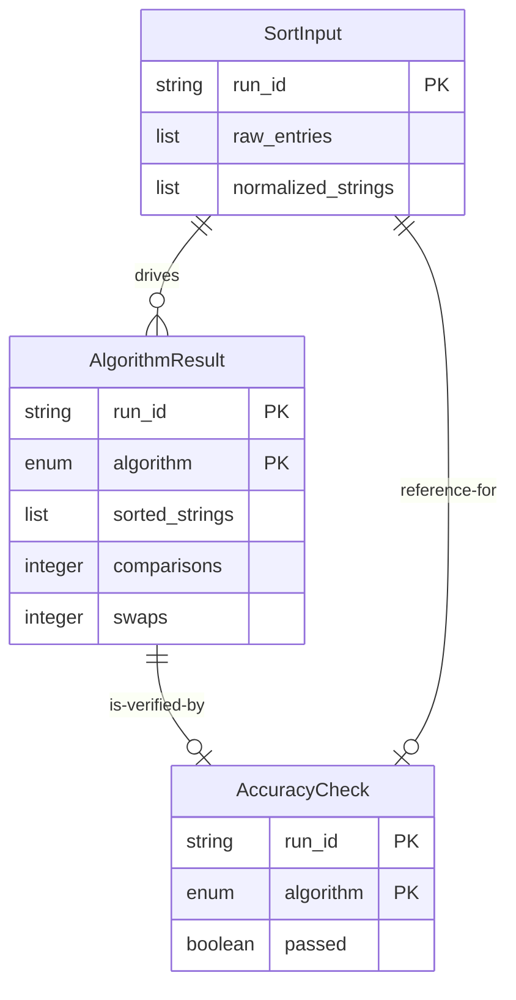

# Domain Entities — U1 sorting-core

Machine-readable catalogue below is the source of truth; the human-readable view is derived from it.

## YAML Source of Truth

```yaml
entities:
  - name: SortInput
    summary: "One normalized set of strings to be sorted, generated per Sort button press."
    identifier: run_id
    ownership:
      component: InputProcessor
      responsibility: "Generate run_id and normalize raw entries"
    attributes:
      - name: run_id
        type: string
        description: "Unique identifier for this sort run (UUID or timestamp-based, generated by InputProcessor.normalize)"
        nullable: false
        immutable: true
      - name: raw_entries
        type: list[string]
        description: "Original entries as provided by the caller (typed lines plus picked words from the bundled list). May contain duplicates, empty tokens, mixed case, and non-ASCII characters."
        nullable: false
        immutable: true
        examples: ["['Alice', 'bob', '', 'Alice', 'cäfe']"]
      - name: normalized_strings
        type: list[string]
        description: "Processed entries after normalization: split on newlines and commas, trimmed, empty tokens dropped, ASCII capitals lowercased, non-ASCII pass-through. Duplicates preserved. Because one entry may split into several tokens, its length is bounded by the total delimiter count rather than by len(raw_entries)."
        nullable: false
        immutable: true
        examples: ["['alice', 'bob', 'alice', 'cäfe']"]
    constraints:
      - "run_id must be unique across all SortInput objects in a single run session"
      - "normalized_strings must not be empty when passed to SortingEngine.run_all() — caller (U2) validates and handles empty case with FR6.1 message"
      - "All strings in normalized_strings must be non-empty after normalization"
    lifecycle:
      created_by: "InputProcessor.normalize()"
      consumed_by: "SortingEngine.run_all(), AccuracyChecker.check()"
      lifetime: "One sort run; discarded when user provides new input"

  - name: AlgorithmResult
    summary: "Output of one sorting algorithm on one SortInput: sorted strings, comparison count, swap count."
    identifier: [run_id, algorithm]
    ownership:
      component: SortingEngine
      responsibility: "Implement algorithm, count comparisons and swaps, return result"
    attributes:
      - name: run_id
        type: string
        description: "Copied from SortInput.run_id to link result to input"
        nullable: false
        immutable: true
      - name: algorithm
        type: enum
        enum_values: ["bubble", "selection", "quick"]
        description: "Which algorithm produced this result"
        nullable: false
        immutable: true
      - name: sorted_strings
        type: list[string]
        description: "Result of sorting normalized_strings in lexicographic (Unicode) order using this algorithm. Empty list if input was empty."
        nullable: false
        immutable: true
        examples: ["['alice', 'alice', 'bob', 'cäfe']"]
      - name: comparisons
        type: integer
        description: "Total number of element comparisons performed (the primary step metric, FR4.2). Defined as every comparison of two elements in the sorting algorithm, including all passes through outer/inner loops and all comparisons during partitioning and recursion. Same definition for all three algorithms to enable direct comparison."
        nullable: false
        min: 0
        immutable: true
        examples: ["6 for bubble sort on 4 items; 6 for selection sort on 4 items"]
      - name: swaps
        type: integer
        description: "Total number of element swaps performed (secondary metric, FR4.3). Algorithm-specific: bubble sort counts adjacent swaps, selection sort counts post-selection swaps, quick sort counts partitioning swaps. Only exchanges that change the array are counted — self-exchanges and exchanges of equal values are no-ops and are excluded, so already-sorted and all-identical input yield 0 for every algorithm."
        nullable: false
        min: 0
        immutable: true
        examples: ["0 for sorted input; algorithm-dependent for unsorted input"]
    constraints:
      - "(run_id, algorithm) pair uniquely identifies one result within a run"
      - "comparisons >= 0; for empty input or single element, comparisons = 0"
      - "swaps >= 0; for already-sorted input, swaps = 0"
      - "sorted_strings must equal sorted(normalized_strings) exactly (ascending Unicode lexicographic order)"
      - "len(sorted_strings) must equal len(SortInput.normalized_strings)"
    lifecycle:
      created_by: "SortingEngine.run_all()"
      consumed_by: "AccuracyChecker.check() (per algorithm), U2 for display"
      lifetime: "One sort run; discarded when user provides new input"
    references:
      - entity: SortInput
        owned_by: InputProcessor
        relationship: "Each AlgorithmResult is derived from exactly one SortInput"
        constraint: "run_id must match"

  - name: AccuracyCheck
    summary: "Verification result: did this algorithm's output match the reference (Python sorted())?"
    identifier: [run_id, algorithm]
    ownership:
      component: AccuracyChecker
      responsibility: "Compare result against Python sorted() and report pass/fail"
    attributes:
      - name: run_id
        type: string
        description: "Copied from SortInput.run_id to link check to input"
        nullable: false
        immutable: true
      - name: algorithm
        type: enum
        enum_values: ["bubble", "selection", "quick"]
        description: "Which algorithm this check verifies"
        nullable: false
        immutable: true
      - name: passed
        type: boolean
        description: "True if AlgorithmResult.sorted_strings exactly equals sorted(SortInput.normalized_strings) position by position; false otherwise."
        nullable: false
        immutable: true
    constraints:
      - "(run_id, algorithm) pair uniquely identifies one check within a run"
      - "passed = true only when sorted_strings equals sorted(normalized_strings) element-by-element"
      - "Each algorithm is checked independently; failure of one does not affect others"
    lifecycle:
      created_by: "AccuracyChecker.check()"
      consumed_by: "U2 for display"
      lifetime: "One sort run; discarded when user provides new input"
    references:
      - entity: AlgorithmResult
        owned_by: SortingEngine
        relationship: "Each AccuracyCheck verifies exactly one AlgorithmResult"
        constraint: "run_id and algorithm must match"
      - entity: SortInput
        owned_by: InputProcessor
        relationship: "Each AccuracyCheck compares AlgorithmResult against SortInput.normalized_strings"
        constraint: "run_id must match"

```

> Scope note: `BundledWordList` and the bundled word list are owned by U2 (`unit-of-work.md`, `WordListProvider`); they are not part of U1's entity model and are therefore not defined here.

---

## Entity Relationship Diagram



Text fallback: `SortInput` (identifier: `run_id`) generates the input for three `AlgorithmResult` objects (identifier: `run_id + algorithm`). Each `AlgorithmResult` is verified by one `AccuracyCheck` (identifier: `run_id + algorithm`), which also references the original `SortInput`.

---

## Entity Ownership Summary

| Entity | Owning Component | Identifier | When Created | When Consumed | Lifetime |
|---|---|---|---|---|---|
| SortInput | InputProcessor | run_id | User clicks Sort; U2 invokes normalize() | Passed to SortingEngine and AccuracyChecker | One sort run |
| AlgorithmResult | SortingEngine | run_id + algorithm | SortingEngine.run_all() (three per run) | Displayed by U2; verified by AccuracyChecker | One sort run |
| AccuracyCheck | AccuracyChecker | run_id + algorithm | AccuracyChecker.check() (three per run) | Displayed by U2 | One sort run |

---

## Constraints and Validation Rules

### SortInput Validation

1. `run_id` must be non-empty and unique within a session
2. `raw_entries` must be a list (may be empty; U2 validates before calling)
3. `normalized_strings` is computed from `raw_entries`:
   - Split each entry on `\n` and `,`
   - Trim leading/trailing whitespace from each token
   - Drop empty tokens
   - Lowercase ASCII capital letters (`A`–`Z` → `a`–`z`)
   - Pass non-ASCII characters through unchanged
   - Preserve duplicates
4. After normalization, all strings must be non-empty
5. For empty `normalized_strings`, U1 returns empty results; U2 handles the FR6.1 message before calling

### AlgorithmResult Validation

1. `run_id` must match the input SortInput.run_id
2. `algorithm` must be one of: bubble, selection, quick
3. `sorted_strings` must be in ascending lexicographic (Unicode) order
4. `len(sorted_strings)` must equal `len(normalized_strings)` from input
5. `comparisons` >= 0, integer
6. `swaps` >= 0, integer
7. For edge cases:
   - Empty input: `sorted_strings = []`, `comparisons = 0`, `swaps = 0`
   - Single element: `sorted_strings = [element]`, `comparisons = 0`, `swaps = 0`
   - All identical: `sorted_strings = input`, `swaps = 0` (no real exchange is possible); comparisons are still performed (bubble and selection do n*(n-1)/2, quick varies)

### AccuracyCheck Validation

1. `run_id` must match the input SortInput.run_id
2. `algorithm` must be one of: bubble, selection, quick
3. `passed = true` only when `AlgorithmResult.sorted_strings` equals `sorted(SortInput.normalized_strings)` **exactly**
   - Compared position by position; duplicate strings are identical, so this is a plain equality test
   - One mismatch → `passed = false`
4. Each algorithm checked independently; no cascade failures

---

## Design Rationale

### Why These Entities?

1. **SortInput** — Captures the normalized input needed for accurate comparisons. Separates raw input (which may be dirty) from normalized input (clean, ready to sort). Enables reproducibility and testing.

2. **AlgorithmResult** — Encapsulates the output of one algorithm on one input: the sorted list plus the two metrics (comparisons and swaps). The composite key `(run_id, algorithm)` ensures results are linked to their input and algorithm.

3. **AccuracyCheck** — Separates verification logic from sorting. Enables testing of accuracy checking independently from the algorithms. Makes pass/fail explicit in the data model.

### Why Comparisons as the Primary Metric?

- **FR4.2** explicitly requires "total element comparisons" as "the primary comparable count… to enable direct comparison" across all three algorithms.
- Comparisons are measurable and deterministic for all three algorithms: every time two elements are tested, it counts.
- Swaps, by contrast, vary in meaning across algorithms (bubble = adjacent swap, selection = post-selection swap, quick = partitioning swap), so they are not directly comparable.
- Swaps are included as a secondary metric for educational value, but the UI's primary focus is comparisons.

### Why Sorted-Output Equality?

- **FR3.1** requires an "exact order match" against Python's `sorted()`.
- The elements are strings, so two equal elements are literally identical; the sorted list therefore has exactly one achievable order. Every correct algorithm produces that list, and internal sort stability is not observable in the result.
- The accuracy check compares the output to `sorted()` element-by-element, which every correct algorithm satisfies.

---

## Edge Cases Handled by Entity Definitions

| Case | SortInput | AlgorithmResult | AccuracyCheck |
|---|---|---|---|
| Empty input | normalized_strings = [] | sorted_strings = [], comparisons = 0, swaps = 0 | passed = true ([] == sorted([])) |
| Single element | normalized_strings = [s] | sorted_strings = [s], comparisons = 0, swaps = 0 | passed = true |
| All identical | normalized_strings = [s, s, s, ...] | sorted_strings = [s, s, s, ...], comparisons >= 0, swaps = 0 | passed = true (identical preserves input order) |
| Mixed ASCII/non-ASCII | normalized_strings preserves order after normalization | sorted by Unicode lexicographic | passed if == sorted() on mixed input |
| Duplicates present | duplicates preserved | output preserves duplicates in sorted order | passed if output equals sorted() |
