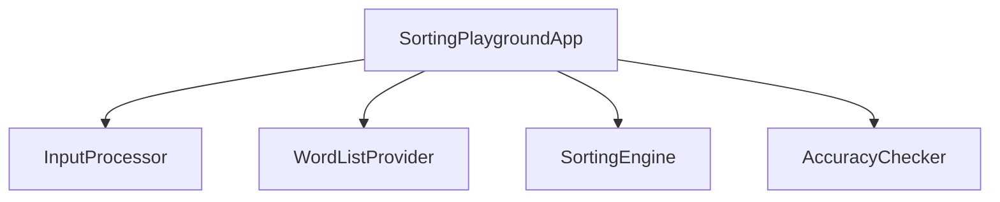

# Domain Design — Components

Machine-readable catalogue below is the source of truth; the human-readable view is derived from it.

```yaml
components:
  - name: SortingPlaygroundApp
    summary: Streamlit presentation and orchestration layer for the single-page sorting playground.
    behaviour: >
      Wires Streamlit widgets to domain components. On Sort press it builds the shared list
      via InputProcessor (typed entries plus picked words), renders the exact FR6.1 warning
      and stops when that list is empty, otherwise runs all three algorithms through
      SortingEngine on the same SortInput, verifies each result through AccuracyChecker,
      and renders the input echo and three result columns. Holds no sorting, normalization,
      or verification logic.
    responsibilities:
      - Render the single screen (input row, Sort button, input echo, three result columns, empty-state hint)
      - Orchestrate the normalize, sort-all-three, verify, render pipeline on button press
      - Render the FR6.1 empty-input warning when the shared list is empty
    depends_on:
      - component: InputProcessor
        interaction: normalize typed and picked entries into a SortInput
        style: sync
      - component: WordListProvider
        interaction: read the bundled options for the word picker
        style: sync
      - component: SortingEngine
        interaction: run all three algorithms on the same SortInput
        style: sync
      - component: AccuracyChecker
        interaction: verify each AlgorithmResult against the reference order
        style: sync
    dependents: []
    external_dependencies:
      - name: Streamlit
        kind: other
        purpose: UI framework runtime for the single-page application
    entities: []

  - name: InputProcessor
    summary: Turns raw typed and picked entries into one normalized SortInput.
    behaviour: >
      Splits entries on line breaks and commas, trims whitespace, drops empty tokens,
      lowercases ASCII capital letters, and passes non-ASCII characters through unchanged.
      Produces a single SortInput per run so every algorithm receives identical data.
      Performs no sorting and no I/O.
    responsibilities:
      - Apply the normalization rule (FR1.3, FR1.4)
      - Drop empty tokens before sorting (FR6.4)
      - Merge typed entries and picked words into one ordered list
    depends_on: []
    dependents:
      - component: SortingPlaygroundApp
        interaction: called once per Sort press
    external_dependencies: []
    entities:
      - name: SortInput
        identifier: run_id
        attributes: [run_id, raw_entries, normalized_strings]
        references: []

  - name: SortingEngine
    summary: Runs bubble, selection, and quick sort on one SortInput and reports the shared metrics.
    behaviour: >
      Implements the three algorithms over lexicographic string order. Each run counts
      element comparisons (the single comparable step metric, FR4.2) and swaps (FR4.3) with
      one definition shared by all three algorithms. Returns one AlgorithmResult per
      algorithm. Accepts no algorithm beyond these three (NFR3.1). Pure computation; no I/O.
    responsibilities:
      - Implement bubble sort, selection sort, and quick sort (FR2.1–FR2.3)
      - Apply one comparison and swap counting definition across all three (FR4.1–FR4.5)
      - Return results in a shared shape per algorithm
    depends_on: []
    dependents:
      - component: SortingPlaygroundApp
        interaction: called once per Sort press with the shared SortInput
    external_dependencies: []
    entities:
      - name: AlgorithmResult
        identifier: run_id + algorithm
        attributes: [run_id, algorithm, sorted_strings, comparisons, swaps]
        references:
          - entity: SortInput
            owned_by: InputProcessor
            relationship: each AlgorithmResult is derived from exactly one SortInput

  - name: AccuracyChecker
    summary: Verifies each algorithm's output against the reference order.
    behaviour: >
      Compares an AlgorithmResult's sorted_strings with Python's built-in sorted() applied
      to the same SortInput. Exact order match means pass; any difference means fail. Each
      algorithm is checked independently. Pure computation; no I/O.
    responsibilities:
      - Compute pass or fail per algorithm (FR3.1–FR3.3)
      - Keep the reference rule in one place
    depends_on: []
    dependents:
      - component: SortingPlaygroundApp
        interaction: called once per AlgorithmResult after sorting
    external_dependencies: []
    entities:
      - name: AccuracyCheck
        identifier: run_id + algorithm
        attributes: [run_id, algorithm, passed]
        references:
          - entity: AlgorithmResult
            owned_by: SortingEngine
            relationship: each AccuracyCheck verifies exactly one AlgorithmResult

  - name: WordListProvider
    summary: Supplies the fixed word list bundled with the application.
    behaviour: >
      Exposes one fixed, non-empty list of common words shipped inside the package. No
      network access, no file I/O at runtime (FR1.5, AC1.2.3). The list does not change
      between runs.
    responsibilities:
      - Own the bundled word list and its version (FR1.5)
      - Expose the list to the picker as read-only options
    depends_on: []
    dependents:
      - component: SortingPlaygroundApp
        interaction: read once per page render to populate the picker
    external_dependencies: []
    entities:
      - name: BundledWordList
        identifier: list_version
        attributes: [list_version, words]
        references: []
```

## Component Diagram



Text fallback: `SortingPlaygroundApp` depends on `InputProcessor`, `WordListProvider`, `SortingEngine`, and `AccuracyChecker`. The four domain components depend on nothing and call nothing.

## Component Summary

| Component | Purpose | Depends On | Dependents | Entities Owned |
|---|---|---|---|---|
| SortingPlaygroundApp | Single-screen UI and pipeline orchestration | InputProcessor, WordListProvider, SortingEngine, AccuracyChecker | none | none |
| InputProcessor | Normalize typed and picked entries into one SortInput | none | SortingPlaygroundApp | SortInput |
| SortingEngine | Bubble, selection, quick sort with shared counting | none | SortingPlaygroundApp | AlgorithmResult |
| AccuracyChecker | Pass/fail against Python sorted() | none | SortingPlaygroundApp | AccuracyCheck |
| WordListProvider | Fixed bundled word list | none | SortingPlaygroundApp | BundledWordList |

## Entity Ownership

| Entity | Owning Component | Identifier | Attributes | References |
|---|---|---|---|---|
| SortInput | InputProcessor | run_id | run_id, raw_entries, normalized_strings | none |
| AlgorithmResult | SortingEngine | run_id + algorithm | run_id, algorithm, sorted_strings, comparisons, swaps | SortInput (InputProcessor) |
| AccuracyCheck | AccuracyChecker | run_id + algorithm | run_id, algorithm, passed | AlgorithmResult (SortingEngine) |
| BundledWordList | WordListProvider | list_version | list_version, words | none |

## External Dependencies

| Component | Dependency | Kind | Purpose |
|---|---|---|---|
| SortingPlaygroundApp | Streamlit | other (UI framework) | Runtime for the single-page UI |

Python's built-in `sorted()` is the accuracy reference inside AccuracyChecker. It is standard library, not an external dependency, so it is not listed here.

## Rationale

| Component | Why it is a separate building block |
|---|---|
| SortingPlaygroundApp | Distinct concern (presentation and orchestration). Changes when the UI changes, not when algorithms change. Keeping it thin lets the domain run under pytest without a Streamlit runtime (ADR-004). |
| InputProcessor | Distinct concern (normalization and empty-token rules, FR1.3, FR1.4, FR6.4). Its rules change independently of the algorithms. |
| SortingEngine | Distinct concern (sorting and metric counting). Shares one counting definition across all three algorithms (ADR-002). |
| AccuracyChecker | Distinct concern (verification). Its reference rule can change independently of the sorting implementations, and keeping it separate keeps verification testable on its own (ADR-003). |
| WordListProvider | Distinct data ownership (FR1.5). Gives the bundled list an explicit owner and a contract that can be tested independently. Alternatives considered: a constant inside the UI (ADR-001, Option B). |

**Alternatives Rejected (component boundary):** a single domain module (Option C) and a four-component variant that inlines the word list (Option B). See ADR-001 in `decisions.md`.

## Dependency Graph Check

- No component depends on itself.
- `depends_on` and `dependents` are symmetric: SortingPlaygroundApp lists the four domain components in `depends_on`, and each domain component lists SortingPlaygroundApp in `dependents`.
- Every entity has exactly one owner and an identifier.
- Every `references.entity` is declared under its `owned_by` component.
- The graph is acyclic.
